  

<h1 align="center">Swedish Blockchain & Fullstack Developer</h1>

  Building secure decentralized systems and production-ready applications across smart contracts, backend infrastructure and modern web interfaces.

  

<h3 align="center">Blockchain</h3>

  
  
  
  
  
  
  
  

<h3 align="center">Frontend</h3>

  
  
  
  
  
  
  
  
  

<h3 align="center">Backend & Data</h3>

  
  
  
  
  
  

<h3 align="center">Testing, CI & Development</h3>

  
  
  
  
  
  
  
  

  Clean architecture · Automated testing · CI/CD · Security-first development

